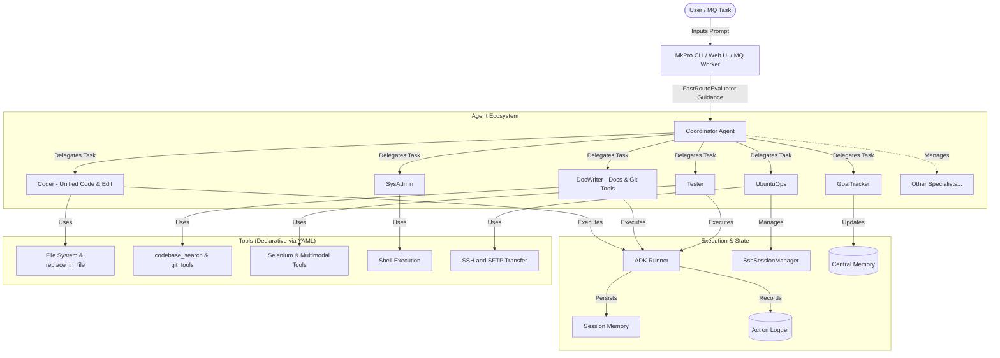

# mkpro - The AI Software Engineering Team (v4.9.0)

`mkpro` is an advanced, modular CLI and Web assistant built on the Google Agent Development Kit (ADK). It orchestrates a team of **15 specialized AI agents** to autonomously handle complex software engineering tasks, from coding, surgical refactoring, and testing to security audits, remote Linux infrastructure management, multimodal analysis, and distributed queue worker execution. It supports a multi-provider backend, allowing you to mix and match local models (Ollama, vLLM/OpenAI, Jlama) with powerful cloud models (Gemini, Bedrock, Azure, Sarvam).

## 🤖 Meet the Team

Your `mkpro` instance is not just a chatbot; it's a team of experts led by a Coordinator with centralized routing guidance (`FastRouteEvaluator.formatRoutingGuidance()`).

| Agent | Role & Capabilities |
| :--- | :--- |
| **Coordinator** | **Team Lead**. Orchestrates the workflow, receives high-confidence routing guidance (`FastRouteEvaluator.formatRoutingGuidance()`), manages long-term memory, and delegates tasks to the right specialist. It is your primary interface. |
| **GoalTracker** | **Project Manager**. Keeps track of ongoing session goals, creates TODO lists for complex tasks, and maintains progress in a local MapDB store. |
| **Coder** | **Software Engineer & Code Manipulator**. Unified agent for reading, analyzing, writing, and refactoring code (`CodeEditor` merged into `Coder`). Equipped with `replace_in_file` for surgical edits on large files, `safe_write_file` with diff preview and automatic backups (`Maker.backItUp`), **Graph Memory**, **codebase search**, and in-process Groovy scripting. |
| **SysAdmin** | **System Operator**. Executes local shell commands, manages local infrastructure, and runs build tools (Maven, Gradle, npm). *Restricted from modifying code directly or managing git.* |
| **UbuntuOps** | **Persistent Remote Sandbox & SSH Specialist**. Manages persistent SSH sessions, executes remote commands, handles remote security policies, and transfers files via SFTP. |
| **GitAgent** | **Version Control Specialist**. Stages, commits, and pushes code. Enforces semantic commit messages and appends AI session token statistics to commit history. |
| **Tester** | **QA Engineer**. Writes unit and integration tests, runs test suites, performs browser-based E2E testing via Selenium, and inspects visual/audio artifacts (`vision`, `audio`). |
| **DocWriter** | **Technical Writer**. Maintains `README.md`, `AGENTS.md`, `AGENT.md`, and Javadocs/Docstrings. Equipped with `codebase_search`, `git_tools` (`git_log`, `git_diff`, `git_status`, `git_show`), and `replace_in_file` to inspect code/commits and update documentation surgically. |
| **SecurityAuditor** | **Security Analyst**. Scans code for vulnerabilities (SQLi, XSS, secrets), runs audit tools (`npm audit`), and recommends hardening steps. |
| **Architect** | **Principal Engineer**. Reviews high-level design, analyzes cohesion/coupling, enforces design patterns, plans refactoring, and uses **Graph Memory** to store and retrieve system designs. |
| **DatabaseAdmin** | **DBA**. Writes complex SQL queries, creates schema migration scripts, and analyzes database structures. |
| **DevOps** | **SRE / Cloud Engineer**. Writes Dockerfiles, Kubernetes manifests, CI/CD configs, and interacts with cloud CLIs (AWS, GCP). |
| **DataAnalyst** | **Data Scientist**. Analyzes data sets (CSV, JSON), executes in-process Groovy scripts or Python scripts (pandas, numpy), processes audio (`audio`), and generates insights. |
| **AndroidDev** | **Mobile Engineer (Android)**. Expert in Kotlin, Jetpack Compose, Android SDK, and Gradle-based Android projects. |
| **IosDev** | **Mobile Engineer (iOS)**. Expert in Swift, SwiftUI, Xcode, and iOS frameworks. |
| **ProductManager** | **Product Lead**. Defines product requirements (PRDs), writes INVEST user stories and acceptance criteria, prioritizes roadmaps, and tracks product decisions in Graph Memory. |

### Agent Interaction Flow



## 🏗️ Architecture

### Core Components

| Component | Responsibility |
| :--- | :--- |
| `BootstrapService` | Application initialization, service wiring, MQ worker startup, shutdown hooks |
| `AgentManager` | Creates LLM instances, builds runners, manages delegation tools and multimodal sub-agent forwarding |
| `ToolRegistry` | Maps declarative tool names (from YAML) to `BaseTool` instances |
| `AgentFactory` | Builds `LlmAgent` from `AgentDefinition` + resolved tools |
| `CentralMemory` | Persistent state store (hot/shared split architecture) with project-scoped configs, notes, and tasks |
| `FastRouteEvaluator` | Evaluates intent & Markov confidence to inject centralized routing guidance into the Coordinator |
| `RabbitMqWorkerService` | Distributed and local queue task consumer supporting `RABBITMQ`, `INTERNAL`, and `AUTO` modes |
| `MkProContext` | Application state container passed to commands and UI |
| `TerminalUI` | JLine-based interactive terminal loop with `@` note/task autocomplete |

### CentralMemory Architecture & Modernized Storage

CentralMemory uses a **hot/shared split** for multi-instance safety with a fully modernized, platform-aware storage layout:

- **Hot Store** (per-instance, always open): Agent statistics — high-frequency writes with zero contention between instances.
- **Shared Store** (brief file lock with retry): Agent configs (global and project-scoped), sticky notes, tasks, goals, memories, OpenAI/vLLM & Ollama servers, MCP servers — opened briefly for writes, reads served from in-memory cache.
- **Local Cache**: `ConcurrentHashMap` for configs, volatile lists for servers. Populated on startup, invalidated on writes, refreshable via `refreshCache()` when SyncEngine receives peer updates.
- **Platform-Aware Directory Standards**: Stores databases, configs, caches, and logs in OS-standard locations:
  - **Windows**: `%APPDATA%\mkpro` (roaming/shared data and configuration) and `%LOCALAPPDATA%\mkpro` (local cache/temp).
  - **Linux / macOS**: `$XDG_CONFIG_HOME/mkpro` (or `~/.config/mkpro`) and `$XDG_DATA_HOME/mkpro` (or `~/.local/share/mkpro`).
- **Zero Workspace Root Pollution**: All persistent databases, telemetry, and temporary files reside cleanly within the user's OS application directories, keeping repository workspaces untainted.

### Declarative Tool Assignment

Agent tools are defined in team YAML files rather than hardcoded:

```yaml
agents:
  - name: Coder
    tools: [file_read, file_write, safe_write, clipboard, codebase_search, mcp_scan, graph_memory, fetch_url, vision, ask_peer_agent, scripting, request_knowledge]

  - name: DocWriter
    tools: [file_read, file_write, safe_write, clipboard, fetch_url, codebase_search, git_tools]

  - name: SysAdmin
    tools: [shell, file_read, file_write, safe_write, clipboard, scripting, ssh]

  - name: UbuntuOps
    tools: [ssh, file_read, file_write, safe_write, shell, clipboard, codebase_search, central_memory, fetch_url]

  - name: Tester
    tools: [file_read, file_write, safe_write, clipboard, shell, selenium, vision, audio]
```

Available tool names: `file_read`, `file_write`, `safe_write` (includes surgical `replace_in_file`), `clipboard`, `shell`, `image`, `vision` (`analyze_image`), `audio` (`transcribe_audio`), `codebase_search`, `multi_project_search`, `git_tools`, `mcp_scan`, `graph_memory`, `fetch_url`, `stats`, `selenium`, `scripting`, `verify_fact`, `ssh`, `ssh_exec`, `ssh_file_transfer`, `ssh_list_sessions`, `screen_capture`, `ask_peer_agent`, `request_knowledge`, `central_memory`, `index_codebase`.

---

## 🚀 Key Features in v4.9.0

### 1. 🖥️ Multi-Server OpenAI / vLLM Support (`/vllm` & `/openai`)

Manage multiple OpenAI-compatible and vLLM inference servers alongside Ollama and cloud providers:
- **Interactive CLI Command (`/vllm` or `/openai`)**:
  - `/vllm list` — List all registered OpenAI/vLLM endpoints with API key status, active selection, and resolved `maxContextTokens`.
  - `/vllm add <name> <url> [apiKey] [maxContext]` — Add a new vLLM/OpenAI endpoint (auto-appends `/v1` if omitted and auto-detects `max_model_len` from `/v1/models` when `maxContext` is not explicitly supplied).
  - `/vllm remove <name>` — Remove a registered endpoint.
  - `/vllm select <name>` — Set the default active OpenAI/vLLM endpoint and rebuild the runner.
  - `/vllm context <name> <limit>` — Dynamically update `maxContextTokens` for a specific named server and rebuild the runner.
  - `/vllm models [name]` — Query `/v1/models` on the selected or specified server to list available models.
  - `/vllm status` — Check connectivity, model count, and context limits across all registered OpenAI/vLLM servers.
- **Configurable `maxContextTokens`**:
  - Configure a global default in `config.properties` via `openai.max.context.tokens` (or env `OPENAI_MAX_CONTEXT_TOKENS`, default `100000`).
  - Configure per-server overrides in `config.properties` via `openai.provider.<name>.max.context.tokens` (or env `OPENAI_PROVIDER_<NAME>_MAX_CONTEXT_TOKENS`) or interactively via `/vllm context <name> <limit>`.
  - `AgentManager` automatically applies token-aware context truncation on `OpenAiBaseLM` instances using the resolved limit.
- **Custom Model Entry & Default Gemma-4 QAT Models**:
  - Default OpenAI/vLLM model registry includes quantized Gemma-4 instruction-tuned models (`google/gemma-4-31B-it-qat-w4a16-ct`, `google/gemma-4-12B-it-qat-w4a16-ct`, `google/gemma-4-e4B-it-qat-w4a16-ct`, `google/gemma-4-e2B-it-qat-w4a16-ct`) alongside `gpt-4o` and `gpt-4o-mini`.
  - `/config` supports entering custom model names directly and assigning models prefixed by server name (e.g., `serverName/modelName`).

### 2. 👁️🎙🎬 Multimodal Vision, Audio & Video Support

Full end-to-end multimodal capabilities across local and cloud providers (powered by ADK `1.12.1-SNAPSHOT`):
- **Inline Image, Audio & Video Payloads**:
  - `OpenAiBaseLM` and `OllamaBaseLM` natively serialize inline images, audio (`input_audio` content blocks), and video (`video_url` content blocks).
  - Web UI and REST/WebSocket chat accept multimodal attachments (images, audio, video) and stream them directly to the active runner.
- **Sub-Agent Media Forwarding**:
  - When the `Coordinator` delegates a task to a specialist sub-agent (`Coder`, `Tester`, `Architect`, `DataAnalyst`, etc.), `AgentManager` automatically forwards attached multimodal `Part` objects (images, audio, video) to the sub-agent's execution session so specialists can inspect media directly.
- **Multi-Provider `VisionTool` (`analyze_image`) & `AudioTranscriptionTool` (`transcribe_audio`)**:
  - `VisionTool` (`analyze_image`) and `AudioTranscriptionTool` (`transcribe_audio`) dynamically route requests across **GEMINI**, **OPENAI / vLLM**, **OLLAMA**, **BEDROCK**, **AZURE**, and **SARVAM** based on the agent's configured provider or available fallback credentials.

### 3. 📁 Project-Scoped Configurations & Project-Grouped Sticky Notes & Tasks

Work seamlessly across multiple repositories without losing per-project preferences or context:
- **Project-Scoped Settings (`/config`, `/web`, `/compact`)**:
  - `/config` saves agent provider/model assignments scoped to the current project path by default, falling back to global configurations when a project-specific override is not set. Use `/config global` to view or modify global defaults, or `/config reset` to clear project overrides.
  - `/web` preferences (such as preferred port and auto-launch settings) and `/compact` event-filtering thresholds are persisted per project in `CentralMemory`.
- **Left-Side Sticky Notes & Tasks Panel (`📌 Notes`)**:
  - Available in both the Academic Research View (`/`) and Classic View (`/classic`), the `📌 Notes` slide-out drawer organizes Sticky Notes and Tasks into **collapsible per-project groups**.
  - The **`Current` project group is expanded by default**, while other projects are neatly collapsed so you stay focused on the active workspace.
- **`@` Notation & Interactive Autocomplete in Chat & CLI**:
  - Reference any Sticky Note or Task directly in prompts using `@[Note Title]`, `@[Task: Title]`, `@slug`, or `@id`.
  - `CentralMemory.resolveNoteMentions()` automatically expands references inline with the full note content or task details before sending the prompt to the agent.
  - Typing `@` in the Web UI chat input or JLine CLI (`TerminalUI`) triggers an interactive autocomplete menu **filtered strictly to current-project notes and unfinished tasks**.

### 4. 🧠 Web UI Model & Server Configuration Modal (`🧠 Models`)

Configure every agent's LLM provider, model, and inference server directly from the browser without touching the CLI:
- **Quick Access**: Click the floating **`🧠` button** next to the `Send` button in the chat composer or the **`🧠 Models` button** in the top header bar.
- **2-Tab Interactive Configuration Modal**:
  - **Tab 1 — Agent Models**: View and update the `Provider`, `Server` (for `OPENAI`/`vLLM` and `OLLAMA`), and `Model` (with dynamic server model discovery or custom model text entry) for `ALL` agents at once or per individual specialist (`Coordinator`, `Coder`, `DocWriter`, etc.). Displays scope badges (`Project` vs `Global`) and supports 1-click project config reset.
  - **Tab 2 — Inference Servers**: Add, inspect, test connectivity, update `maxContextTokens`, select default, or remove **vLLM / OpenAI** and **Ollama** server endpoints in real time.
- **Backing REST Endpoints**: Powered by `/api/config/state`, `/api/config/server-models`, `/api/config/agent`, `/api/config/reset`, and `/api/config/servers`.

### 5. 🛠️ Agent Architecture Updates (`Coder`, `DocWriter` & Routing Guidance)

Streamlined agent responsibilities for faster, higher-accuracy execution:
- **`CodeEditor` Merged into `Coder`**:
  - `Coder` is now the single unified software engineering specialist responsible for code analysis, new feature implementation, refactoring, and surgical file modifications.
  - `Coder` is equipped with `replace_in_file` (for surgical search-and-replace edits on large files >300 lines without truncation) and `safe_write_file` (two-step diff preview with automatic backup).
  - Legacy references or Markov predictions targeting `CodeEditor` are automatically normalized to `Coder`.
- **Enhanced `DocWriter`**:
  - `DocWriter` now includes `codebase_search`, `git_tools` (`git_log`, `git_diff`, `git_status`, `git_show`), and `replace_in_file`, enabling it to autonomously inspect commit histories, search implementation details, and apply surgical documentation updates.
- **Coordinator-Centralized Routing Guidance**:
  - `FastRouteEvaluator.formatRoutingGuidance()` evaluates incoming prompts using keyword directives and the `MarkovRouter` transition matrix. When confidence meets the threshold (`>= 65%`), it injects structured `[Routing Guidance: Recommended specialist agent is '...']` into the Coordinator prompt while keeping multi-step planning centralized in the Coordinator.

### 6. 🐇 RabbitMQ & Built-In Internal Queue Worker Mode (`/mq` & Scripts)

Run `mkpro` as a scalable background task worker or enqueue asynchronous prompts locally and across distributed brokers:
- **Three Queue Modes (`RABBITMQ@, `INTERNAL`, `AUTO`)**:
  - `RABBITMQ`: Connects to an external AMQP RabbitMQ broker (`mkpro.tasks`, `mkpro.results`, `mkpro.tasks.dlq`).
  - `INTERNAL`: **Zero-dependency in-memory queue** paired with a lightweight loopback HTTP bridge on `http://127.0.0.1:8765` (`/mq/status`, `/mq/publish`, `/mq/results`) so external processes and test clients can submit tasks and poll results without installing RabbitMQ.
  - `AUTO` (Default): Attempts to connect to the configured RabbitMQ broker first and **automatically falls back to `INTERNAL` mode** if no broker is reachable.
- **Interactive `/mq` CLI Command**:
  - `/mq on [internal|rabbitmq|auto]` — Start the MQ task worker in the specified mode.
  - `/mq off` — Gracefully stop the active MQ worker and close connections.
  - `/mq status` — Display worker status (`ONLINE`/`OFFLINE`), active mode, HTTP bridge URL, broker details, queue depths (`pending`, `results`, `dlq`), and processed task counters.
  - `/mq config [host] [port] [user] [pass] [taskQueue] [resultQueue]` — View or update persistent RabbitMQ broker settings in `CentralMemory`.
  - `/mq send <prompt>` — Enqueue an asynchronous task prompt directly from the CLI.
  - `/mq results [limit]` — View recent completed/failed task results recorded by the worker.
- **Worker & End-to-End Test Scripts**:
  - Launch a dedicated headless worker instance (`--worker`) or run the end-to-end test suite (`MqTestClient`):
    ```bash
    # Linux / macOS: Start mkpro in Worker Mode (defaults to AUTO mode)
    ./mkpro-worker.sh

    # Windows: Start mkpro in Worker Mode
    mkpro-worker.bat

    # Run end-to-end MQ verification (auto-detects RabbitMQ or Internal HTTP bridge, or spawns an embedded worker)
    ./mkpro-mq-test.sh --mode auto
    ./mkpro-mq-test.sh --mode internal --prompt "Summarize the project architecture in 3 bullet points."
    mkpro-mq-test.bat --mode internal
    ```

---

## 🎓 Academic Research View & Modern UI

`mkpro` features a modern UI architecture with dual-view routing and publication-grade aesthetics:

- **Academic Research View (Default Route `/`)**: Serving `academic_view.html` at `http://localhost:8080/`, this default view provides a distraction-free, publication-styled workbench optimized for in-depth code reading, literature synthesis, and architectural research. Features minimalist editorial aesthetics with **EB Garamond** serif typography, left-side collapsible project Sticky Notes & Tasks (`📌 Notes`), interactive Model & Server Config modal (`🧠 Models`), on-demand slide-over file explorer (`Ctrl+B`), line-numbered manuscript inspector, multi-modal lightbox zoom (`Ctrl+V`), and 1-click response copying.
- **Classic View (`/classic`)**: Access the traditional dashboard and terminal-style layout via `http://localhost:8080/classic`.
- **Cross-Navigation Header Links**: Seamlessly toggle between Academic View, Classic View, Sticky Notes (`📌 Notes`), Model Config (`🧠 Models`), Knowledge Dashboard (`/knowledge`), MapDB browser (`/db`), and Sandbox credentials.

## 👁️ Modular File Inspector & Media Viewers

The web interface includes an advanced, feature-rich file and artifact inspection suite:

- **Dual-Mode Tabbed Viewer**: Instantly switch between `[ 👁️ Rendered Preview ]` and `[ 📝 Source Code ]` for Markdown and HTML documents.
- **Integrated PDF.js Canvas Viewer**: Native client-side PDF rendering with page navigation, zoom controls, and text selection.
- **Lightbox Image Pan/Zoom & Binary Fallbacks**: High-resolution image inspection with interactive zoom/pan capabilities and informative fallback cards for binary or unsupported artifacts.

## 🖥️ Multi-Monitor Screen Capture (`/capture`)

Capture and analyze visual context directly from your desktop environments:
- **Multi-Monitor Screenshot Engine**: Automatically discovers and captures screenshots across all active displays, saving artifacts to `.mkpro/captures/`.
- **Interactive Chat Cards**: Rendered thumbnails in the chat stream with instant inspection.
- **Automatic File Inspector Popup**: Opens captured images directly in the Modular File Inspector for deep visual review by vision-capable models (e.g., Gemini, GPT-4o, Gemma-4).

## ⚡ Smart Event Filtering Plugin (`/compact`)

Powered by the Google ADK `SmartEventFilterPlugin`, `mkpro` maintains optimal context windows during long-running sessions with project-scoped persistence:
- **Anchor Pinning**: Automatically preserves critical reference points including Turn 0 user goal, system instructions, and pinned memory events.
- **Tool Output Pruning & Churn Eviction**: Automatically prunes oversized tool outputs (> 2KB) and evicts stale tool churn.
- **Interactive Slash Commands**:
  - `/compact [turns]` — Compacts conversation history.
  - `/compact filter` — Displays event filtering statistics.
  - `/compact prune <chars>` — Adjusts tool output pruning threshold (saved per project).
  - `/compact churn <on|off>` — Toggles stale tool churn eviction (saved per project).

## 📦 Persistent Remote Sandbox & SSH Infrastructure (`UbuntuOps`)

`mkpro` features robust remote infrastructure management through the dedicated `UbuntuOps` specialist agent:
- **Persistent `SshSessionManager`**: Manages persistent SSH sessions with automatic keep-alive, session aliasing, and multiplexing.
- **Web UI `📦 Sandbox` Credentials Modal**: Secure credential configuration supporting Password authentication, SSH Key Files, and Inline Private Keys.
- **AES-GCM Encryption in MapDB**: All sensitive credentials are encrypted using AES-GCM and securely stored in CentralMemory MapDB.
- **Startup Auto-Reconnecting**: Automatically re-establishes persistent SSH sessions upon application startup.
- **High-Speed Bidirectional SFTP**: Transfer files seamlessly between local workspaces and remote sandboxes using `ssh_file_transfer` or `/ssh transfer`.
- **Remote Security Policies**: Enforced `RemoteCommandPolicy` and `RemotePathValidator` preventing dangerous operations (e.g., destructive deletions or root-level modifications) on remote systems.

## 🌐 REST API

When running with `--web`, mkpro exposes a full HTTP REST API alongside the WebSocket chat. No additional configuration needed.

### Endpoints

| Method | Endpoint | Description |
| :--- | :--- | :--- |
| `POST` | `/api/chat` | Synchronous chat — send message (supports `@` mentions), get full response |
| `POST` | `/api/chat/stream` | Streaming chat via Server-Sent Events (SSE) |
| `POST` | `/api/command` | Execute CLI commands (`/know`, `/vllm`, `/mq`, `/status`, `/ssh`, etc.) |
| `GET` | `/api/status` | System info (version, runner, scheduler, Markov stats) |
| `GET` | `/api/agents` | List all agents with tools, model, and provider |
| `GET` | `/api/config/state` | Full model & server configuration state (project vs global, agents, servers) |
| `GET` | `/api/config/server-models` | Fetch available models from a specific vLLM/OpenAI or Ollama server |
| `POST` | `/api/config/agent` | Update provider/model assignment for `ALL` or a specific agent (project or global) |
| `POST` | `/api/config/reset` | Reset project-scoped agent model overrides back to global defaults |
| `POST` | `/api/config/servers` | Add, remove, select, or update context limits for vLLM/OpenAI & Ollama servers |
| `GET` | `/api/notes` | List Sticky Notes (grouped by project, with `currentProject` flag) |
| `POST` | `/api/notes` | Create or update a project-scoped or global Sticky Note |
| `DELETE` | `/api/notes?id=` | Delete a Sticky Note |
| `GET` | `/api/tasks` | List Tasks (grouped by project, with `currentProject` flag) |
| `POST` | `/api/tasks` | Create or update a project-scoped or global Task |
| `DELETE` | `/api/tasks?id=` | Delete a Task |
| `GET` | `/api/knowledge` | All knowledge topics as JSON |
| `GET` | `/api/knowledge/search?q=` | TF-IDF knowledge search |
| `POST` | `/api/knowledge/topics` | Add a new knowledge topic |
| `DELETE` | `/api/knowledge/topics?name=` | Remove a knowledge topic |
| `GET` | `/api/git/branch` | Current branch + all local/remote branches |
| `POST` | `/api/git/switch` | Switch git branch (with multi-user confirmation) |
| `GET` | `/api/files?path=` | List project directory contents |
| `GET` | `/api/file-content?path=` | Read file content (10KB cap) |
| `GET` | `/api/file-raw?path=` | Raw binary file with MIME type (20MB cap) |
| `GET` | `/api/history?offset=&limit=` | Paginated chat history |
| `POST` | `/api/edit/approve` | Approve pending file edit |
| `POST` | `/api/edit/reject` | Reject pending file edit |
| `GET` | `/api/edit/pending` | List pending edit proposals |
| `GET` | `/api/db` | MapDB store browser (all stores as JSON) |

### Usage Examples

```bash
# Ask a question (synchronous, blocks until complete)
curl -X POST http://localhost:8080/api/chat \
  -H "Content-Type: application/json" \
  -d '{"message": "explain the Markov router architecture"}'

# Stream response (Server-Sent Events)
curl -N -X POST http://localhost:8080/api/chat/stream \
  -H "Content-Type: application/json" \
  -d '{"message": "write unit tests for TopicIndex"}'

# Execute a CLI command (e.g., check vLLM or MQ status)
curl -X POST http://localhost:8080/api/command \
  -H "Content-Type: application/json" \
  -d '{"command": "/mq status"}'

# Get model & server configuration state
curl http://localhost:8080/api/config/state

# Get system status
curl http://localhost:8080/api/status

# List all agents
curl http://localhost:8080/api/agents

# Search knowledge base
curl "http://localhost:8080/api/knowledge/search?q=kubernetes+security"

# Browse project files
curl "http://localhost:8080/api/files?path=src/main/java/com/mkpro"
```

### Response Format

**POST /api/chat**
```json
{
  "agent": "SecurityAuditor",
  "response": "Here's my analysis of the security...",
  "duration_ms": 3200
}
```

**POST /api/chat/stream** (SSE events)
```
data: {"type":"stream_start","agent":"Coder"}
data: {"type":"chunk","text":"Here's my analysis..."}
data: {"type":"chunk","text":" of the code."}
data: {"type":"stream_end"}
```

**POST /api/command**
```json
{"output": "Knowledge Scheduler Status\n  ✅ kubernetes-security … 2026-07-20T15:30\n..."}
```

### Launching MkPro

On Windows:
```batch
mkpro-web.bat
mkpro-scheduler.bat
mkpro-headless.bat
mkpro-full.bat
mkpro-worker.bat
mkpro-mq-test.bat
```

On Linux / macOS:
```bash
./mkpro-web.sh
./mkpro-scheduler.sh
./mkpro-headless.sh
./mkpro-full.sh
./mkpro-worker.sh
./mkpro-mq-test.sh
```

On first launch, select your execution runner (InMemory, MapDB, or Postgres). Use `/config` (or the Web UI `🧠 Models` modal) to set your default provider and model.

## 📚 Additional Documentation

- **[Agent Architecture & Developer Guide](AGENTS.md)** — Overview of the multi-agent architecture, build commands, package structure, v4.9.0 capabilities, and operational rules.
- **[Knowledge Scheduler](README_knowledge.md)** — Autonomous topic-based knowledge accumulation, TF-IDF search, topic discovery, confidence scoring, and the self-improving flywheel.
- **[Markov Chain Router](README_markov.md)** — Intent classification, transition probability matrix, learned patterns, stall prediction, and training pipeline.
- **[Fact Engine](README_fe.md)** — Verified math formulas, relationship graph, Groovy verification scripts, Knowledge→Fact pipeline, project fact discovery, and confidence scoring.

## 🤝 Contributing

We welcome contributions! Please feel free to submit Pull Requests or open issues for feature requests and bug reports.

## 📜 License

This project is licensed under the Apache License 2.0.
