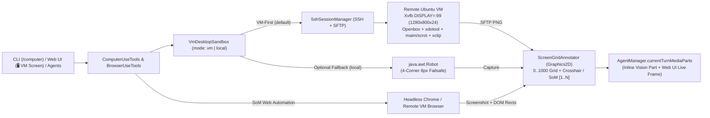

# VM-First Computer Use & Set-of-Mark Browser Use

`mkpro` provides native **Computer Use** (full GUI desktop automation) and **Set-of-Mark (SoM) Browser Use** (visually grounded web automation) powered by a **VM-First** architecture. AI agents interact with an isolated virtual Ubuntu desktop (`DISPLAY=:99`, `1280×800×24`) over a persistent SSH tunnel—keeping the user's host desktop untouched—with an optional local `java.awt.Robot` fallback protected by a 4-corner emergency failsafe.

---

## 1. Architecture Overview



### Core Execution Modes (`VmDesktopSandbox`)

| Mode | Backend | Resolution | Safety & Isolation |
| :--- | :--- | :--- | :--- |
| **`vm` (Default)** | Remote Ubuntu VM running `Xvfb` on `DISPLAY=:99` + `openbox`, controlled via `SshSessionManager` (`xdotool`, `xclip`, `maim`/`scrot`) | `1280×800×24` | Fully isolated virtual display on remote sandbox VM; zero interference with host mouse/keyboard |
| **`local` (Optional)** | Local desktop via `java.awt.Robot` & system clipboard | Native desktop resolution | **Emergency 4-Corner Failsafe** (`8px` margin): moving the physical mouse cursor into any corner of the screen immediately aborts execution |

### Safety & Multimodal Loop
- **Sanitized X11 Execution**: Display identifiers are validated against `^:[0-9]+(\.[0-9]+)?$`. Arbitrary text in `computer_type` is Base64-encoded and pasted via `xclip -selection clipboard` + `ctrl+v` (with `xdotool type` fallback) to prevent shell quoting or injection issues across URLs, symbols, and multi-line inputs.
- **Closed-Loop Vision Feedback**: Every desktop or browser action automatically captures a post-action annotated PNG screenshot (saved under `<mkpro-data-dir>/captures/`), updates the live frame cache (`lastFrameBase64`) for the Web UI, emits an `MkProEvent.system(...)` event, and attaches the image inline to `AgentManager.currentTurnMediaParts` so vision-capable LLMs can verify the exact outcome of each step.

---

## 2. Zero-Sudo User-Space Provisioning

`VmDesktopSandbox.initVmDesktop(alias)` bootstraps the remote Ubuntu X11 stack idempotently without requiring root privileges:

1. **System Install (if available)**: Checks for `Xvfb`, `openbox`, `xdotool`, `maim`, and `xclip`; attempts `sudo -n apt-get install` or `apt-get install` first.
2. **Zero-Sudo Fallback (`~/.local/mkpro_gui`)**: When `sudo`/root access is unavailable (e.g., restricted sandbox VMs), `mkpro` downloads the required `.deb` packages into `/tmp/mkpro_debs` via `apt-get download`—with a direct `curl` fallback to Ubuntu archive mirrors (`ports.ubuntu.com/ubuntu-ports` for `arm64`/`aarch64` or `archive.ubuntu.com/ubuntu` for `amd64`)—and extracts them into user-space with `dpkg-deb -x`:
   - Packages provisioned: `xvfb`, `openbox` (`libobt2v5`, `libobrender32v5`), `xdotool` (`libxdo3`), `maim` (`libslopy7.6`, `libglew2.2`), `scrot`, `xclip`.
3. **Automatic Environment Prefix**: Every remote X11 command automatically exports:
   ```bash
   export PATH="$HOME/.local/mkpro_gui/usr/bin:$PATH"
   export LD_LIBRARY_PATH="$HOME/.local/mkpro_gui/usr/lib/aarch64-linux-gnu:$HOME/.local/mkpro_gui/usr/lib/x86_64-linux-gnu:$LD_LIBRARY_PATH"
   export DISPLAY=:99
   ```
4. **Daemon Startup & Capture Chain**: Launches `Xvfb :99 -screen 0 1280x800x24 -ac` and `openbox` detached via `setsid`, verifying socket readiness at `/tmp/.X11-unix/X99`. Screenshot capture chains `maim` → `scrot -o` → `import -window root` and transfers the frame over SFTP.

---

## 3. Visual Grounding (`ScreenGridAnnotator`)

`com.mkpro.infra.computer.ScreenGridAnnotator` is a pure Java `Graphics2D` annotator that provides resolution-independent spatial grounding for Vision-Language Models (VLMs):

### Normalized `[0..1000]` Coordinate Grid & Action Crosshair
- All desktop pointer tools operate in a normalized **`[0..1000] × [0..1000]`** coordinate space (`(0,0)` = top-left, `(500,500)` = center, `(1000,1000)` = bottom-right), mapped and clamped via `normToPixelX/Y` and `pixelToNormX/Y`.
- **`annotateWithGridAndCrosshair()`** renders:
  - Subtle dashed cyan/dark reference grid lines every **100 normalized units** (`100..900`) with dark-pill numeric tick labels along the top and left edges.
  - A high-contrast **red target ring and crosshair** (with white outer halo) plus an **action-label pill** (e.g., `click(500,320,btn=1)`) at the executed coordinate so agents can self-correct misclicks on the next turn.

### Set-of-Mark (SoM) `[1..N]` Bounding Boxes
- **`BrowserUseTools.SOM_INJECTION_JS`** inspects the active viewport for up to **80 visible interactive DOM elements** (`a[href]`, `button`, `input`, `select`, `textarea`, `[role="button|link|checkbox|tab"]`, `[onclick]`, `summary`), tags each element with `data-mkpro-som-id="1..N"`, and extracts bounding rectangles and accessible labels.
- **`annotateWithSomBadges()`** overlays color-coded translucent bounding boxes (8-color palette) with high-contrast **`[1..N]` corner number badges** directly onto the browser screenshot and returns a concise structured catalog:
  ```text
  [1] <a role="link"> "Documentation" (norm=214,48)
  [2] <input role="search"> "Search docs..." (norm=512,48)
  [3] <button role="button"> "Submit" (norm=685,48)
  ```

---

## 4. Agent Tool Suites

Both suites are registered declaratively in `ToolRegistry` under `computer_use` (alias `computer`) and `browser_use` (alias `browser`)—as well as individual tool names—and are enabled by default in `teams/default.yaml` for **`Coder`**, **`SysAdmin`**, **`Tester`**, and **`UbuntuOps`**.

### `ComputerUseTools` (`computer_use`)

| Tool | Parameters | Description |
| :--- | :--- | :--- |
| `computer_init_vm` | `alias` *(opt)* | Provisions (if needed) and starts `Xvfb :99` (`1280×800×24`) + `openbox` on the remote SSH VM. |
| `computer_screenshot` | `alias` *(opt)*, `show_grid` *(bool, default `true`)* | Captures a frame from VM `:99` (or local desktop), overlays the `0..1000` grid, and attaches it inline for Vision analysis. |
| `computer_click` | `x` *(req)*, `y` *(req)*, `button` *(1\|2\|3)*, `double_click` *(bool)*, `alias` | Clicks at normalized `[0..1000]` coordinates and captures a verification screenshot with a red crosshair. |
| `computer_move_or_drag` | `to_x` *(req)*, `to_y` *(req)*, `from_x`, `from_y`, `drag` *(bool)*, `alias` | Moves the pointer or performs a left-button drag-and-drop between normalized coordinates, followed by a verification screenshot. |
| `computer_type` | `text` *(req)*, `press_enter` *(bool)*, `alias` | Types arbitrary text into the focused window (Base64 clipboard paste + `ctrl+v`, optional `Return`) and captures a screenshot. |
| `computer_key` | `key` *(req)*, `alias` | Sends a key or shortcut combo (`Return`, `Escape`, `Tab`, `BackSpace`, `ctrl+l`, `ctrl+c`, `alt+F4`, etc.) and captures a screenshot. |
| `computer_scroll` | `x`, `y`, `direction` *(`down`\|`up`\|`left`\|`right`)*, `clicks` *(default `4`)*, `alias` | Scrolls the mouse wheel at normalized `(x, y)` and captures a verification screenshot. |
| `computer_launch_app` | `command` *(req)*, `alias` | Launches an X11 GUI app in the background on `DISPLAY=:99` (e.g., `chromium-browser --no-sandbox https://example.com`, `xterm`) and captures a screenshot. |

### `BrowserUseTools` (`browser_use`)

| Tool | Parameters | Description |
| :--- | :--- | :--- |
| `browser_open` | `url` *(req)*, `target` *(`local`\|`vm`, opt)* | Opens a URL in headless Selenium Chrome (`1280×800`, or remote VM browser if `target="vm"` or local ChromeDriver is unavailable with SSH active) and returns a Set-of-Mark `[1..N]` snapshot. |
| `browser_snapshot` | *(none)* | Refreshes the Set-of-Mark `[1..N]` screenshot overlay and interactive element catalog for the current page. |
| `browser_act` | `action` *(req: `click`\|`type`\|`press_enter`\|`scroll_down`\|`scroll_up`\|`back`\|`hover`)*, `element_id`, `text`, `press_enter`, `x`, `y` | Interacts with an element by Set-of-Mark `element_id` (or fallback normalized `(x, y)` coordinates) and returns a refreshed SoM snapshot. |
| `browser_extract_markdown` | *(none)* | Converts the active page DOM (or last VM URL) into clean Markdown (up to 16,000 chars), preserving headings, links, lists, and code blocks while stripping scripts/styles. |
| `browser_close` | *(none)* | Closes the active Selenium browser session and clears the SoM element map. |

---

## 5. CLI Commands (`/computer`)

Control and test VM or local desktop automation directly from the interactive `mkpro` terminal (`ComputerCommand`):

```bash
# Inspect current mode, SSH status, X11 display, Xvfb state, and last screenshot
/computer status [alias]

# Provision and start Xvfb (:99, 1280x800) + Openbox on the remote SSH VM
/computer init [alias]

# Switch execution mode between remote VM (:99) and local java.awt.Robot
/computer mode <vm|local>

# Capture an annotated 0..1000 grid screenshot (alias: /computer snap)
/computer screenshot [alias]

# Click at normalized [0..1000] coordinates
/computer click <normX> <normY> [alias]

# Type text into the currently focused window
/computer type <text>

# Send a key or shortcut combination (e.g., Return, Escape, ctrl+l, alt+F4)
/computer key <keyCombo>

# Launch a GUI application on DISPLAY=:99
/computer launch <command>

# Open a URL via BrowserUseTools and capture a Set-of-Mark [1..N] snapshot
/computer open <url>
```

---

## 6. Web UI (`🖥️ VM Screen`) & REST API

### Interactive `🖥️ VM Screen` Modal
Available from the top header bar in both the **Academic Research View (`/`)** and **Classic View (`/classic`)**:
- **Live Viewport & Auto-Refresh**: Displays the latest annotated PNG frame (`lastFrameBase64`), status badge (`VM :99 (1280x800) • SSH OK • Xvfb UP`), live hovered coordinate readout (`norm: (x, y)`), and auto-polls `/api/computer/status` every 3 seconds while open.
- **Interactive Click-Through**: Click directly anywhere on the rendered viewport image to dispatch normalized `[0..1000]` **`Left Click`**, **`Double Click`**, **`Right Click`**, or **`Move Only`** actions straight to the VM or local desktop.
- **Quick Controls**: Switch SSH alias, toggle **`Mode: VM (:99)`** vs **`Mode: Local Desktop`**, click **`⚡ Init VM (:99)`** or **`🔄 Capture Screen`**, open URLs (`🌐 Open URL`), type text (`⌨️ Type`), send common keys (`⏎ Enter`, `⇥ Tab`, `Esc`, `⌫`), and scroll (`▲ Scroll`, `▼ Scroll`).

### REST API Endpoints

| Method | Endpoint | Request Body / Query | Description |
| :--- | :--- | :--- | :--- |
| `GET` | `/api/computer/status` | `?alias=default` | Returns mode, SSH connectivity, `display`, resolution, `xvfbRunning`, `lastAction`, `lastScreenshotPath`, and `lastFrameBase64`. |
| `POST` | `/api/computer/init` | `{"alias": "default"}` | Provisions/starts `Xvfb :99` + `openbox`, captures an initial annotated screenshot, and returns status + `lastFrameBase64`. |
| `GET` / `POST` | `/api/computer/screenshot` | `?alias=default` or `{"alias": "default"}` | Captures and returns an annotated screenshot with `0..1000` grid overlay and `lastFrameBase64`. |
| `POST` | `/api/computer/action` | `{"alias": "default", "action": "...", ...}` | Dispatches an interactive desktop/browser action and returns updated status + post-action `lastFrameBase64`. |

Supported `action` values for `POST /api/computer/action`:
- `mode` (`mode: "vm" | "local"`)
- `click`, `double_click`, `right_click` (`x`, `y` in `0..1000`)
- `move`, `drag` (`from_x`, `from_y`, `x`, `y` in `0..1000`)
- `type` (`text`, `pressEnter`)
- `key` (`key`, e.g., `"Return"`, `"ctrl+l"`)
- `scroll` (`x`, `y`, `direction`, `clicks`)
- `launch` (`command`)
- `open_url` (`url`)

#### Example `curl` Workflow
```bash
# 1. Initialize remote VM virtual desktop (:99)
curl -X POST http://localhost:8080/api/computer/init \
  -H "Content-Type: application/json" \
  -d '{"alias": "default"}'

# 2. Open a URL in the browser
curl -X POST http://localhost:8080/api/computer/action \
  -H "Content-Type: application/json" \
  -d '{"alias": "default", "action": "open_url", "url": "https://example.com"}'

# 3. Click normalized coordinate (500, 320)
curl -X POST http://localhost:8080/api/computer/action \
  -H "Content-Type: application/json" \
  -d '{"alias": "default", "action": "click", "x": 500, "y": 320}'
```
